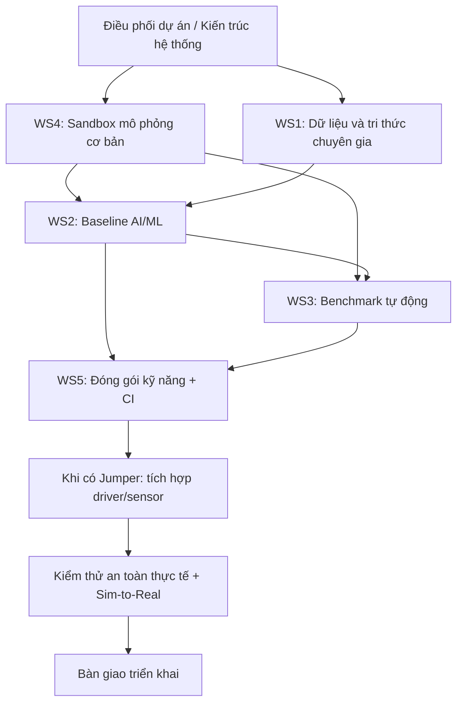

# Jumper AI Lab — Sơ đồ công việc và hướng dẫn 15 vị trí

> Bản nháp tài liệu để đưa vào Git. Chưa tự động push hoặc deploy.

## Sơ đồ công việc

Sơ đồ dưới đây mô tả luồng phụ thuộc ở mức công việc. Các liên kết trong sơ đồ và danh sách bên dưới dẫn tới file Markdown hướng dẫn từng vị trí.



**Nếu GitHub không cho bấm trực tiếp vào ô của sơ đồ**, dùng danh sách liên kết chắc chắn bên dưới. Sơ đồ được render bằng Mermaid; một số nơi hiển thị Mermaid có thể chặn liên kết bên trong sơ đồ.

## Danh sách 15 hướng dẫn công việc

1. [Điều phối dự án / Kiến trúc hệ thống](docs/roles/01-dieu-phoi-kien-truc.md) — WS0
2. [Kỹ sư thu thập dữ liệu](docs/roles/02-thu-thap-du-lieu.md) — WS1
3. [Kỹ sư xử lý dữ liệu](docs/roles/03-xu-ly-du-lieu.md) — WS1
4. [Chuyên gia kỹ năng / tri thức chuyên gia](docs/roles/04-chuyen-gia-ky-nang.md) — WS1
5. [Kỹ sư dữ liệu / quản lý tri thức](docs/roles/05-quan-ly-tri-thuc.md) — WS1
6. [Kỹ sư AI/ML](docs/roles/06-baseline-ai-ml.md) — WS2
7. [Kỹ sư học bắt chước](docs/roles/07-hoc-bat-chuoc.md) — WS2
8. [Kỹ sư học tăng cường / huấn luyện](docs/roles/08-hoc-tang-cuong.md) — WS2
9. [Kỹ sư điều khiển robot](docs/roles/09-dieu-khien-robot.md) — WS2
10. [Kỹ sư mô phỏng / sandbox](docs/roles/10-sandbox-mo-phong.md) — WS4
11. [Kỹ sư tạo môi trường / randomization](docs/roles/11-tao-moi-truong.md) — WS4
12. [Kỹ sư benchmark / đánh giá](docs/roles/12-benchmark-danh-gia.md) — WS3
13. [Kỹ sư kiểm thử tự động](docs/roles/13-kiem-thu-tu-dong.md) — WS3
14. [Kỹ sư đóng gói kỹ năng và CI](docs/roles/14-dong-goi-skill-ci.md) — WS5
15. [Kỹ sư tích hợp phần cứng và an toàn](docs/roles/15-tich-hop-phan-cung-an-toan.md) — WS5

## Quy tắc làm việc chung

- Không ghi là hoàn thành nếu chưa chạy hoặc chưa kiểm tra được.
- Không tự giả định một tính năng có sẵn trong Jumper; xác minh theo repo và tài liệu thực tế.
- Video quan sát không tự động chứa lệnh điều khiển, mô-men xoắn hay trạng thái cảm biến.
- Công việc cần robot thật phải đánh dấu **chờ phần cứng**; không thay kiểm thử thực tế bằng kết quả mô phỏng.
- Mỗi thay đổi nên có mô tả, cách kiểm tra và bằng chứng; không commit khóa API, mật khẩu hoặc dữ liệu riêng tư.

## Cách đưa lên GitHub bằng PowerShell

Giải nén file ZIP vào máy. Mở PowerShell tại thư mục repo `jumper-ai-lab-Teravel-Industries`, rồi chạy:

```powershell
# Kiểm tra nhánh và thay đổi trước khi thêm file
git status

# Sao chép README.md và thư mục docs từ gói này vào thư mục repo hiện tại
# (điều chỉnh đường dẫn nguồn cho đúng nơi bạn đã giải nén)
Copy-Item "C:\DUONG_DAN\jumper-task-docs\README.md" ".\README.md" -Force
Copy-Item "C:\DUONG_DAN\jumper-task-docs\docs" ".\docs" -Recurse -Force

git add README.md docs
oles
git diff --cached --stat
git diff --cached --check

# Chỉ commit/push khi đã xem diff và đồng ý nội dung
git commit -m "Add Jumper task guides and workflow diagram"
git push origin main
```

## Notes / security

- Dữ liệu không nằm trong RAM của Vercel: tài khoản và nhiệm vụ được lưu ở Supabase. Vì vậy dữ liệu vẫn còn sau khi deploy lại, miễn là project/database còn tồn tại.
- Gói miễn phí có giới hạn và chính sách ngủ/tạm dừng có thể thay đổi; kiểm tra trang giá hiện hành của Supabase/Vercel.
- `SUPABASE_SERVICE_ROLE_KEY` chỉ được đặt trong Environment Variables phía server Vercel. Không đặt nó trong biến `VITE_*`, không commit file `.env`.
- Đây là bản starter; trước khi dùng dữ liệu nhạy cảm, cần kiểm thử RLS/quyền truy cập và thiết lập sao lưu. Không dùng mật khẩu chung giữa các thành viên.
- Website tự làm mới danh sách mỗi 12 giây; không cần giữ máy tính quản lý bật.

Thay `C:\DUONG_DAN\jumper-task-docs` bằng đường dẫn thật sau khi giải nén. Nếu repo dùng nhánh khác `main`, thay tên nhánh tương ứng.

**Lưu ý:** `git push` có thể kích hoạt Vercel deploy nếu repo đang bật triển khai tự động. Chỉ push khi đã sẵn sàng deploy.
## Luồng công việc chính

[Xem 5 Workstream và sơ đồ phụ thuộc](docs/WORKSTREAMS.md)
