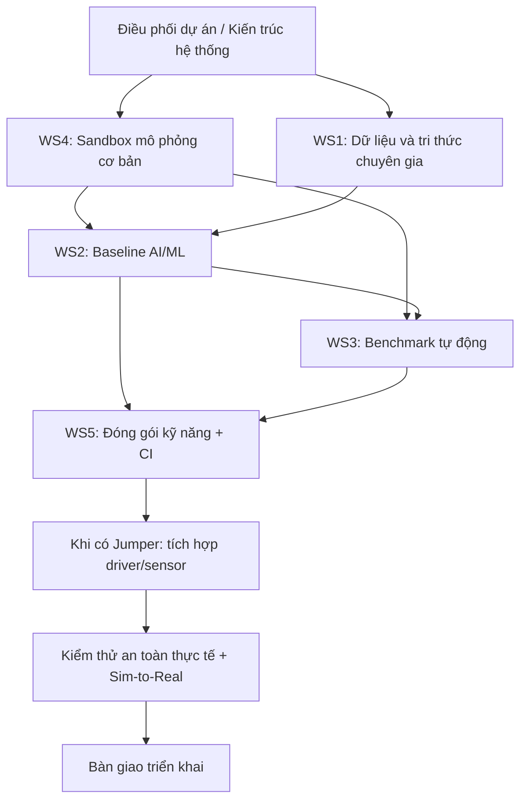

# Jumper AI Lab — Sơ đồ công việc và hướng dẫn 15 vị trí

> Tài liệu phân công công việc cho dự án Jumper AI Lab.

## 1. Sơ đồ công việc

Sơ đồ mô tả luồng phụ thuộc giữa các nhóm. Có thể bấm vào từng ô để mở hướng dẫn tương ứng; nếu liên kết trong sơ đồ không hoạt động, sử dụng danh sách liên kết ở phần 2 và phần 3.



## 2. Danh sách 15 hướng dẫn công việc

1. [Điều phối dự án / Kiến trúc hệ thống](docs/roles/01-dieu-phoi-kien-truc.md) — WS0
2. [Kỹ sư thu thập dữ liệu](docs/roles/02-thu-thap-du-lieu.md) — WS1
3. [Kỹ sư xử lý dữ liệu](docs/roles/03-xu-ly-du-lieu.md) — WS1
4. [Chuyên gia kỹ năng / Tri thức chuyên gia](docs/roles/04-chuyen-gia-ky-nang.md) — WS1
5. [Kỹ sư dữ liệu / Quản lý tri thức](docs/roles/05-quan-ly-tri-thuc.md) — WS1
6. [Kỹ sư AI/ML](docs/roles/06-baseline-ai-ml.md) — WS2
7. [Kỹ sư học bắt chước](docs/roles/07-hoc-bat-chuoc.md) — WS2
8. [Kỹ sư học tăng cường / Huấn luyện](docs/roles/08-hoc-tang-cuong.md) — WS2
9. [Kỹ sư điều khiển robot](docs/roles/09-dieu-khien-robot.md) — WS2
10. [Kỹ sư mô phỏng / Sandbox](docs/roles/10-sandbox-mo-phong.md) — WS4
11. [Kỹ sư tạo môi trường / Randomization](docs/roles/11-tao-moi-truong.md) — WS4
12. [Kỹ sư benchmark / Đánh giá](docs/roles/12-benchmark-danh-gia.md) — WS3
13. [Kỹ sư kiểm thử tự động](docs/roles/13-kiem-thu-tu-dong.md) — WS3
14. [Kỹ sư đóng gói kỹ năng và CI](docs/roles/14-dong-goi-skill-ci.md) — WS5
15. [Kỹ sư tích hợp phần cứng và an toàn](docs/roles/15-tich-hop-phan-cung-an-toan.md) — WS5

## 3. Hướng dẫn theo nhóm công việc

- [WS0 — Điều phối dự án / Kiến trúc hệ thống](docs/roles/01-dieu-phoi-kien-truc.md)
- [WS1 — Thu thập dữ liệu](docs/roles/02-thu-thap-du-lieu.md)
- [WS2 — Baseline AI/ML](docs/roles/06-baseline-ai-ml.md)
- [WS3 — Benchmark và đánh giá](docs/roles/12-benchmark-danh-gia.md)
- [WS4 — Sandbox mô phỏng](docs/roles/10-sandbox-mo-phong.md)
- [WS5 — Đóng gói kỹ năng và CI](docs/roles/14-dong-goi-skill-ci.md)
- [Tích hợp phần cứng và an toàn](docs/roles/15-tich-hop-phan-cung-an-toan.md)
- [Xem 5 Workstream và sơ đồ phụ thuộc](docs/WORKSTREAMS.md)

## 4. Quy tắc làm việc chung

- Không ghi là hoàn thành nếu chưa chạy hoặc chưa kiểm tra được.
- Không tự giả định một tính năng có sẵn trong Jumper; cần xác minh theo repository và tài liệu thực tế.
- Video quan sát không tự động chứa lệnh điều khiển, mô-men xoắn hay trạng thái cảm biến.
- Công việc cần robot thật phải được đánh dấu **chờ phần cứng**; không thay kiểm thử thực tế bằng kết quả mô phỏng.
- Mỗi thay đổi cần có mô tả, cách kiểm tra và bằng chứng.
- Không commit khóa API, mật khẩu hoặc dữ liệu riêng tư.

## 5. Cập nhật GitHub bằng PowerShell

Mở PowerShell tại thư mục repository `jumper-ai-lab-Teravel-Industries`.

Kiểm tra thay đổi:

```powershell
git status
git diff --check
git diff -- README.md
```

Nếu nội dung đã đúng, thêm và kiểm tra README:

```powershell
git add README.md
git diff --cached --check
git diff --cached --stat
git diff --cached
```

Sau khi xác nhận bản thay đổi đã sẵn sàng, commit:

```powershell
git commit -m "Restore Mermaid diagram links"
```

Chỉ đẩy lên GitHub khi đã sẵn sàng cập nhật repository:

```powershell
git push origin main
```

**Lưu ý:** Nếu repository kết nối Vercel và bật tự động triển khai, lệnh `git push` có thể kích hoạt deploy. Không push nếu chưa sẵn sàng triển khai.

Nếu cần sao chép tài liệu từ một thư mục khác, hãy kiểm tra đường dẫn nguồn thực tế trước khi dùng `Copy-Item`. Không chạy lệnh với đường dẫn mẫu chưa được thay thế.

## 6. Ghi chú bảo mật

- Dữ liệu tài khoản và nhiệm vụ được lưu ở Supabase; không nên coi RAM của Vercel là nơi lưu trữ lâu dài.
- Gói miễn phí có giới hạn và chính sách có thể thay đổi; kiểm tra thông tin hiện hành của Supabase và Vercel.
- `SUPABASE_SERVICE_ROLE_KEY` chỉ được đặt trong biến môi trường phía server. Không đặt khóa này trong biến `VITE_*` hoặc commit file `.env`.
- Trước khi sử dụng dữ liệu nhạy cảm, cần kiểm tra RLS, quyền truy cập và sao lưu.
- Không dùng chung mật khẩu giữa các thành viên.
- Website có thể tự làm mới danh sách theo chu kỳ; không cần giữ máy tính quản lý bật liên tục nếu toàn bộ dịch vụ đã được triển khai trên cloud.

---

[Đọc tài liệu 5 Workstream và sơ đồ phụ thuộc](docs/WORKSTREAMS.md)
