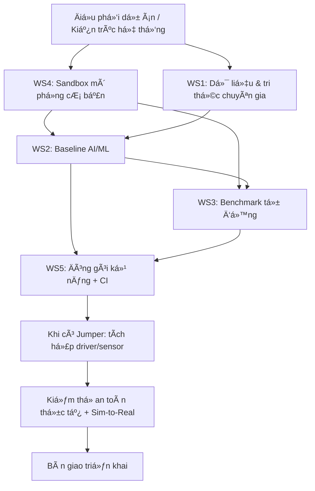

# Jumper AI Lab — Luồng công việc chính (Workstreams)

> Tài liệu tổng quan bổ sung cho README chính. Sơ đồ thể hiện quan hệ phụ thuộc giữa 5 luồng công việc; danh sách bên dưới liên kết tới hướng dẫn Markdown của 15 vị trí trong `docs/roles/`.
>
> **Nguyên tắc phạm vi:** trước khi có robot thật, ưu tiên tài liệu, pipeline dữ liệu có sẵn, mô phỏng, baseline, benchmark và CI. Các mục cần cảm biến/robot thật phải ghi rõ **chờ phần cứng**. Không coi kết quả mô phỏng là bằng chứng đã kiểm thử an toàn ngoài đời.

## 1. Sơ đồ luồng công việc có liên kết

GitHub có thể chặn hoặc không kích hoạt liên kết `click` bên trong Mermaid ở một số chế độ hiển thị. Vì vậy, sơ đồ dưới đây đi kèm danh sách liên kết trực tiếp tới từng hướng dẫn ở mục 3.

## 2. Tổng quan 5 Workstream

### WS1 — Dữ liệu và Tri thức Chuyên gia (Data & Expert Knowledge)

**Mục tiêu:** biến dữ liệu thao tác và kiến thức chuyên gia thành dữ liệu có cấu trúc, có thể kiểm tra và tái sử dụng.

- **Nhiệm vụ:** thu thập video thao tác; khi có thiết bị phù hợp, ghi đồng thời dữ liệu cảm biến như vị trí khớp, tư thế và lực/mô-men. Chia quy trình thành các bước tiếp cận → tiếp xúc → thao tác → hoàn thành → rút lui; gắn nhãn mục tiêu và điều kiện thành công. Xây dựng pipeline đồng bộ timestamp, trích xuất, chuẩn hóa schema và metadata.
- **Vai trò chịu trách nhiệm:** Kỹ sư thu thập dữ liệu, Kỹ sư xử lý dữ liệu, Chuyên gia kỹ năng/tri thức, Kỹ sư dữ liệu/quản lý tri thức; phối hợp với Điều phối/Kiến trúc hệ thống.
- **Đầu vào:** video RGB/RGB-D và quy trình thao tác; dữ liệu cảm biến khi có phần cứng.
- **Đầu ra:** dataset trình diễn có cấu trúc, công cụ xử lý, schema có giải thích đơn vị, metadata và báo cáo chất lượng.
- **Tiêu chí nghiệm thu:** trường dữ liệu và đơn vị được mô tả; metadata rõ; pipeline chạy lại trên dữ liệu mẫu có kết quả kiểm tra được; lỗi thiếu dữ liệu/nhãn mơ hồ được báo cáo. Nếu chưa có sensor, ghi rõ dataset video-only, không giả định có joint state hay lực.
- **Effort:** **M**.
- **Phụ thuộc:** quy trình thao tác và dữ liệu đầu vào; thiết bị quay/cảm biến là phụ thuộc cho thu thập đa phương thức.
- **Rủi ro:** dữ liệu nhiễu hoặc thiếu, timestamp không đồng bộ, nhãn mơ hồ, video không chứa lệnh điều khiển hoặc trạng thái cảm biến.

**Hướng dẫn liên quan:** [02 — Thu thập dữ liệu](docs/roles/02-thu-thap-du-lieu.md) · [03 — Xử lý dữ liệu](docs/roles/03-xu-ly-du-lieu.md) · [04 — Chuyên gia kỹ năng](docs/roles/04-chuyen-gia-ky-nang.md) · [05 — Quản lý tri thức](docs/roles/05-quan-ly-tri-thuc.md)

### WS2 — Mô hình Căn bản và Khởi tạo (Baseline Models)

**Mục tiêu:** xây dựng baseline đơn giản, đo được và tái lập trước khi mở rộng sang mô hình phức tạp.

- **Nhiệm vụ:**
  - **D2.1 — Tái tạo quỹ đạo:** thử GMM/GPR hoặc phương pháp thống kê phù hợp để mô hình hóa/nội suy chuỗi điểm; đo sai số và độ mượt.
  - **D2.2 — Behavior Cloning RNN/LSTM:** nghiên cứu khi có dữ liệu dạng chuỗi trạng thái → hành động phù hợp; so sánh với baseline đơn giản và theo dõi lỗi tích lũy.
  - **D2.3 — Đầu vào đa phương thức:** chỉ tích hợp ảnh, joint state và lực khi các nguồn dữ liệu thực sự có sẵn và đồng bộ.
  - **D2.4 — Inverse Reinforcement Learning (IRL):** hạng mục nghiên cứu thử nghiệm trên tác vụ nhỏ, so sánh với behavior cloning.
  - **D2.5 — GAN / tăng cường dữ liệu:** hạng mục nghiên cứu tùy chọn; chỉ giữ nếu cải thiện được chỉ số đánh giá.
- **Vai trò chịu trách nhiệm:** Nghiên cứu viên AI/ML, Kỹ sư AI/ML, Kỹ sư học bắt chước, Kỹ sư học tăng cường/huấn luyện, Chuyên gia điều khiển.
- **Đầu vào:** dữ liệu đã chuẩn hóa từ WS1 và sandbox/replay từ WS4.
- **Đầu ra:** mã huấn luyện, cấu hình, checkpoint, log, hướng dẫn chạy và kết quả benchmark.
- **Tiêu chí nghiệm thu:** có baseline để so sánh; metrics rõ (ví dụ MSE, độ mượt, success rate nếu có tác vụ thực thi); người khác có thể chạy lại theo hướng dẫn. Không tuyên bố thành công nếu chưa chạy thử.
- **Effort:** **M–L**.
- **Phụ thuộc:** WS1 về dữ liệu; WS4 về môi trường đánh giá.
- **Rủi ro:** quá khớp, thiếu khả năng khái quát, dữ liệu không đủ chất lượng; mô hình phức tạp không tạo cải thiện đáng kể.

**Hướng dẫn liên quan:** [06 — Baseline AI/ML](docs/roles/06-baseline-ai-ml.md) · [07 — Học bắt chước](docs/roles/07-hoc-bat-chuoc.md) · [08 — Học tăng cường](docs/roles/08-hoc-tang-cuong.md) · [09 — Điều khiển robot](docs/roles/09-dieu-khien-robot.md)

### WS3 — Kiểm thử và Đánh giá (Testing & Benchmark)

**Mục tiêu:** đánh giá mô hình/kỹ năng bằng kịch bản, số liệu và báo cáo có thể lặp lại.

- **Nhiệm vụ:** xây dựng bài test cho **tái tạo (reproduction)**, **khái quát hóa (generalization)** và **ứng biến lực (force-adaptation)**. Đo tỷ lệ hoàn thành, sai số, thời gian; thay đổi vị trí/hướng mục tiêu; mô phỏng hoặc kiểm tra phản ứng khi ma sát/lực thay đổi nếu môi trường hỗ trợ.
- **Vai trò chịu trách nhiệm:** Kỹ sư benchmark/đánh giá, Kỹ sư kiểm thử tự động; phối hợp nhóm AI/ML và mô phỏng.
- **Đầu vào:** mô hình/kỹ năng từ WS2 và các scenario từ WS4.
- **Đầu ra:** bộ benchmark, kịch bản kiểm thử, mã tự động, bảng success rate, lỗi và báo cáo so sánh.
- **Tiêu chí nghiệm thu:** kịch bản có điều kiện và metrics được định nghĩa trước; mục tiêu lặp tối thiểu **20 lần mỗi kịch bản** khi khả thi; báo cáo nêu rõ số lần chạy, thất bại và giới hạn. Các ngưỡng như success rate ≥90% cho tái tạo hoặc >70% cho khái quát hóa là **mục tiêu đề xuất cần xác nhận**, không phải kết quả đã đạt.
- **Effort:** **M**.
- **Phụ thuộc:** WS4 về sandbox và WS2 về mô hình.
- **Rủi ro:** kịch bản không đủ đa dạng, metrics không phản ánh độ tin cậy, chênh lệch giữa mô phỏng và thực tế.

**Hướng dẫn liên quan:** [12 — Benchmark/đánh giá](docs/roles/12-benchmark-danh-gia.md) · [13 — Kiểm thử tự động](docs/roles/13-kiem-thu-tu-dong.md)

### WS4 — Môi trường Mô phỏng và Digital Twin (Sandbox & Sim2Real)

**Mục tiêu:** tạo sandbox có thể cấu hình và sinh scenario để phát triển/đánh giá trước khi có robot thật.

- **Nhiệm vụ:** dựng mô hình robot/đối tượng, khớp và va chạm trong simulator phù hợp với repo Jumper (xác minh trước khi chọn MuJoCo/PyBullet). Tạo/reset scenario với vị trí ban đầu, vật cản và tham số vật lý thay đổi. Nghiên cứu Digital Twin/Real-is-Sim, Gaussian Splatting hoặc Position-Based Dynamics như các hạng mục nâng cao, không mặc định là tính năng đã sẵn sàng.
- **Vai trò chịu trách nhiệm:** Kỹ sư mô phỏng/sandbox, Kỹ sư tạo môi trường/randomization, Kỹ sư Robotics, Nhà khoa học Robotics.
- **Đầu vào:** mô hình/thông số robot, đối tượng và dữ liệu phù hợp từ WS1; yêu cầu kiểm thử từ WS3.
- **Đầu ra:** sandbox có cấu hình, scene descriptor/API, scenario generator, hướng dẫn sử dụng và báo cáo ổn định/giới hạn.
- **Tiêu chí nghiệm thu:** chạy ổn định một số kịch bản mẫu; reset và tham số scenario có thể kiểm soát; có test và tài liệu tái lập. Chỉ đánh giá sai lệch mô phỏng–thật khi đã có dữ liệu hoặc robot thật để đối chiếu.
- **Effort:** **L**.
- **Phụ thuộc:** thông số/mô hình robot và yêu cầu từ WS1–WS3; một số kiểm chứng cần phần cứng.
- **Rủi ro:** mô phỏng sai ma sát/va chạm, mô hình không khớp robot thật, tích hợp phức tạp, hiệu chỉnh chậm hoặc không ổn định.

**Hướng dẫn liên quan:** [10 — Sandbox mô phỏng](docs/roles/10-sandbox-mo-phong.md) · [11 — Tạo môi trường/randomization](docs/roles/11-tao-moi-truong.md)

### WS5 — Tích hợp, An toàn và Triển khai (Integration & Deployment)

**Mục tiêu:** đóng gói kỹ năng có phiên bản, kiểm thử tự động và chuẩn bị quy trình tích hợp an toàn.

- **Nhiệm vụ:** định nghĩa skill bundle chứa policy/checkpoint/metadata; quy định API và phiên bản; xây dựng CI để chạy kiểm tra tự động; lập checklist an toàn, giới hạn lực/vận tốc/vùng hoạt động, điều kiện dừng và fail-safe. Khi có robot, tích hợp driver/sensor và thực hiện kiểm thử thực tế theo quy trình được phê duyệt.
- **Vai trò chịu trách nhiệm:** Kỹ sư đóng gói kỹ năng và CI, Kỹ sư tích hợp phần cứng/an toàn, Điều phối dự án/Kiến trúc hệ thống.
- **Đầu vào:** mô hình WS2, sandbox và scenario WS4, kết quả benchmark WS3, dữ liệu/quy trình WS1.
- **Đầu ra:** skill bundle có phiên bản, pipeline CI, hướng dẫn triển khai, checklist an toàn, báo cáo kiểm thử tích hợp.
- **Tiêu chí nghiệm thu:** CI có kiểm tra tự động; artefact có version và hướng dẫn tái lập; kỹ năng chỉ được đưa lên robot khi đạt điều kiện an toàn đã xác định và được kiểm tra trên phần cứng mục tiêu.
- **Effort:** **M**.
- **Phụ thuộc:** đầu ra WS1–WS4; kiểm thử driver/sensor và Sim-to-Real thực tế phụ thuộc robot thật.
- **Rủi ro:** bỏ sót tình huống an toàn, lỗi tương thích driver/sensor, artefact không tương thích, quy trình triển khai thiếu kiểm soát.

**Hướng dẫn liên quan:** [01 — Điều phối/kiến trúc](docs/roles/01-dieu-phoi-kien-truc.md) · [14 — Đóng gói kỹ năng và CI](docs/roles/14-dong-goi-skill-ci.md) · [15 — Tích hợp phần cứng và an toàn](docs/roles/15-tich-hop-phan-cung-an-toan.md)

## 3. Danh sách đầy đủ 15 hướng dẫn vị trí

| STT | Vị trí | Workstream | Hướng dẫn |
|---:|---|---|---|
| 01 | Điều phối dự án / Kiến trúc hệ thống | WS0 — Điều phối | [Mở hướng dẫn](docs/roles/01-dieu-phoi-kien-truc.md) |
| 02 | Kỹ sư thu thập dữ liệu | WS1 — Dữ liệu | [Mở hướng dẫn](docs/roles/02-thu-thap-du-lieu.md) |
| 03 | Kỹ sư xử lý dữ liệu | WS1 — Dữ liệu | [Mở hướng dẫn](docs/roles/03-xu-ly-du-lieu.md) |
| 04 | Chuyên gia kỹ năng / tri thức chuyên gia | WS1 — Dữ liệu | [Mở hướng dẫn](docs/roles/04-chuyen-gia-ky-nang.md) |
| 05 | Kỹ sư dữ liệu / quản lý tri thức | WS1 — Dữ liệu | [Mở hướng dẫn](docs/roles/05-quan-ly-tri-thuc.md) |
| 06 | Kỹ sư AI/ML — baseline | WS2 — AI/ML | [Mở hướng dẫn](docs/roles/06-baseline-ai-ml.md) |
| 07 | Kỹ sư học bắt chước | WS2 — AI/ML | [Mở hướng dẫn](docs/roles/07-hoc-bat-chuoc.md) |
| 08 | Kỹ sư học tăng cường / huấn luyện | WS2 — AI/ML | [Mở hướng dẫn](docs/roles/08-hoc-tang-cuong.md) |
| 09 | Kỹ sư điều khiển robot | WS2 — AI/ML | [Mở hướng dẫn](docs/roles/09-dieu-khien-robot.md) |
| 10 | Kỹ sư mô phỏng / sandbox | WS4 — Mô phỏng | [Mở hướng dẫn](docs/roles/10-sandbox-mo-phong.md) |
| 11 | Kỹ sư tạo môi trường / randomization | WS4 — Mô phỏng | [Mở hướng dẫn](docs/roles/11-tao-moi-truong.md) |
| 12 | Kỹ sư benchmark / đánh giá | WS3 — Đánh giá | [Mở hướng dẫn](docs/roles/12-benchmark-danh-gia.md) |
| 13 | Kỹ sư kiểm thử tự động | WS3 — Đánh giá | [Mở hướng dẫn](docs/roles/13-kiem-thu-tu-dong.md) |
| 14 | Kỹ sư đóng gói kỹ năng và CI | WS5 — Tích hợp | [Mở hướng dẫn](docs/roles/14-dong-goi-skill-ci.md) |
| 15 | Kỹ sư tích hợp phần cứng và an toàn | WS5 — Tích hợp | [Mở hướng dẫn](docs/roles/15-tich-hop-phan-cung-an-toan.md) |

## 4. Quy tắc làm việc chung

- Không ghi là hoàn thành nếu chưa chạy hoặc chưa kiểm tra được.
- Không giả định tính năng có sẵn trong Jumper; xác minh repo và tài liệu thực tế.
- Video quan sát không tự động chứa lệnh điều khiển, mô-men xoắn hay trạng thái cảm biến.
- Việc cần robot thật phải đánh dấu **chờ phần cứng**; không thay kiểm thử thực tế bằng mô phỏng.
- Mỗi thay đổi cần có mô tả, cách kiểm tra và bằng chứng. Không commit API key, mật khẩu hoặc dữ liệu riêng tư.
- Các hướng nghiên cứu nâng cao như IRL, GAN, Gaussian Splatting và Real-is-Sim cần được chia thành thử nghiệm nhỏ; không xem là hạng mục đã triển khai sẵn.
